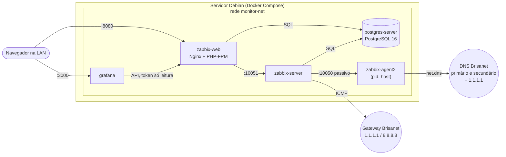

# Lab de Monitoramento: Zabbix 7.0 + Grafana em Docker

Stack de monitoramento para rede residencial rodando em um servidor **Debian headless**: Zabbix 7.0 LTS (Server, Web e Agent 2), PostgreSQL 16 e Grafana, todos em imagens **Alpine**, orquestrados com **Docker Compose** e versionados como código.

O foco é o **servidor** e a **qualidade da conexão com a internet**: disponibilidade, perda de pacotes, latência e DNS, com um diagnóstico em camadas para responder à pergunta *"a internet está ruim, e a culpa é de quem?"*.

> Projeto de estudo e portfólio. Roda apenas na LAN, sem exposição à internet.

---

## Arquitetura



- Só **duas portas** são publicadas no host: `8080` (Zabbix Web) e `3000` (Grafana).
- Banco, Server e Agent só são alcançáveis **dentro da `monitor-net`**, pelo DNS interno do Docker (nome do serviço).
- O Grafana não acessa o banco: consulta a **API do Zabbix** com um token de um usuário **somente leitura**.

## Componentes

| Serviço | Imagem | Porta publicada | Papel |
|---|---|---|---|
| `postgres-server` | `postgres:16-alpine` | não | Banco do Zabbix (volume `postgres_data`) |
| `zabbix-server` | `zabbix/zabbix-server-pgsql:alpine-7.0.32` | não | Coleta, triggers, verificações ICMP (fping) |
| `zabbix-web` | `zabbix/zabbix-web-nginx-pgsql:alpine-7.0.32` | `8080` | Interface web e API |
| `zabbix-agent2` | `zabbix/zabbix-agent2:alpine-7.0.32` | não | Métricas do host e testes de DNS |
| `grafana` | `grafana/grafana` (Alpine; versão fixada no compose) | `3000` | Dashboards (volume `grafana_data`) |

## O que é monitorado

| Host no Zabbix | O que mede | Como |
|---|---|---|
| **Zabbix server** | CPU, memória, disco e processos do servidor; saúde do próprio Zabbix | Agent 2 em modo passivo (templates *Linux by Zabbix agent* e *Zabbix server health*) |
| **Gateway Brisanet** | Disponibilidade, perda e latência da rede local | ICMP (template *ICMP Ping*) |
| **Cloudflare 1.1.1.1** / **Google 8.8.8.8** | Saída para a internet | ICMP, com triggers dependentes do gateway |
| **Zabbix server** (itens extras) | DNS da operadora (primário e secundário) vs DNS público: status e tempo de resposta | `net.dns` e `net.dns.perf` via Agent 2 |

### Diagnóstico em camadas

| Gateway | 1.1.1.1 e 8.8.8.8 | DNS operadora | DNS público | Leitura |
|---|---|---|---|---|
| ✅ | ✅ | ✅ | ✅ | Tudo certo |
| ✅ | ❌ ❌ | | | Problema na operadora |
| ✅ | ✅ ❌ | | | Problema pontual de um provedor, não da conexão |
| ❌ | ❌ ❌ | | | Problema dentro de casa (cabo, switch, roteador) |
| ✅ | ✅ ✅ | ❌ ❌ | ✅ | DNS da operadora fora; trocar o DNS resolve |

Os alvos externos dependem do gateway (**dependência de triggers**): se o gateway cai, chega **um** alerta com a causa real, e não três.

## Consumo de memória

Medido com `docker stats --no-stream` a cada etapa de construção. O host tem **3,7 GiB** de RAM.

| Etapa | Contêineres (MiB) | Total | % da RAM do host |
|---|---|---|---|
| Banco + Zabbix Server | postgres 111,7 a 153,7 · server 53,6 a 54,6 | 166 a 207 MiB | 4,3 a 5,4% |
| + Zabbix Web | postgres 138,8 · web 78,2 · server 70,6 | 288 MiB | 7,5% |
| + Agent 2 | postgres 150,8 · web 126,4 · server 56,5 · agent 14,7 | 348 MiB | 9,1% |
| + Grafana | grafana 381,8 · postgres 115,1 · web 71,6 · server 56,1 · agent 17,4 | **642 MiB** | **16,8%** |

- A stack Zabbix completa, sem o Grafana, fica em torno de **260 MiB**.
- Sozinho, o **Grafana responde por ~60%** do total (backend em Go, plugins embutidos e o processo backend do plugin do Zabbix; 151 PIDs).
- São medições pontuais: o PostgreSQL variou entre 111 e 154 MiB conforme o momento e o cache.


## Estrutura do repositório

```
lab-monitoramento/
├── docker-compose.yml
├── .env.example                  # molde das variáveis (o .env real fica fora do Git)
├── .gitignore
├── docs/
│   ├── diagnostico.md            # runbook: serviço "Up" que não funciona
│   └── img/uso-ram.png
├── grafana/
│   ├── dashboards/internet.json  # dashboard "Internet: Qualidade"
│   └── provisioning/
│       ├── dashboards/provider.yaml
│       ├── datasources/zabbix.yaml
│       └── plugins/zabbix-app.yaml
├── scripts/backup.sh
└── zabbix/export/hosts.yaml      # hosts, itens e triggers exportados do Zabbix
```

## Como subir

**Pré-requisitos:** Docker Engine com o plugin Compose e cerca de 1 GB de RAM livre.

### 1. Clonar e configurar

```bash
git clone https://github.com/julions27/lab-monitoramento.git
cd lab-monitoramento
cp .env.example .env
nano .env
```

| Variável | Uso |
|---|---|
| `POSTGRES_USER`, `POSTGRES_PASSWORD`, `POSTGRES_DB` | Banco do Zabbix (só valem na **primeira** inicialização do volume) |
| `TZ` | Fuso horário (também usado no `PHP_TZ` do frontend) |
| `GRAFANA_ADMIN_PASSWORD` | Senha do admin do Grafana (também só vale na primeira inicialização) |
| `ZABBIX_API_TOKEN` | Token do usuário somente leitura (gerado no passo 4) |

### 2. Subir o Zabbix

```bash
docker compose up -d postgres-server zabbix-server zabbix-web zabbix-agent2
docker compose logs -f zabbix-server     # no primeiro boot, o schema é criado
```

### 3. Configurar o Zabbix (`http://IP_DO_SERVIDOR:8080`)

1. Entre com `Admin` / `zabbix` e **troque a senha imediatamente**.
2. *Data collection → Hosts → Import* → `zabbix/export/hosts.yaml`.
3. Ajuste para a sua rede: o **IP do host Gateway** e os **IPs do DNS da sua operadora** nas chaves dos itens `net.dns` (o trigger acompanha a mudança da chave automaticamente).
4. Refaça as **dependências**: o trigger *Unavailable by ICMP ping* de Cloudflare e Google deve depender do mesmo trigger do Gateway. Dependências adicionadas no host a triggers herdados de template **não entram no export**.

### 4. Usuário somente leitura e token para o Grafana

1. *Users → User groups*: grupo `Grafana (leitura)` com permissão **Read** nos grupos *Internet* e *Zabbix servers*.
2. *Users → Users*: usuário `grafana`, nesse grupo, com o papel `User role`.
3. *Users → API tokens*: crie um token para `grafana` e coloque-o em `ZABBIX_API_TOKEN` no `.env`.

### 5. Subir o Grafana

```bash
docker compose up -d grafana
```

Em `http://IP_DO_SERVIDOR:3000`, entre como `admin` com a senha do `.env`. O datasource e o dashboard **Internet: Qualidade** (pasta *Lab Monitoramento*) são criados a partir dos arquivos do repositório.

## Decisões de projeto

| Decisão | Por quê |
|---|---|
| Imagens Alpine com **tags fixas** | Baixo consumo e reprodutibilidade; atualizar vira uma decisão consciente (muda a tag, testa, commita) |
| Rede bridge própria (`monitor-net`) | DNS interno por nome de serviço; nada exposto sem necessidade |
| Só `8080` e `3000` publicadas | Banco, Server e Agent ficam inacessíveis pela LAN. Observação: portas publicadas pelo Docker passam por fora das regras do UFW |
| Segredos só no `.env`, e cada serviço recebe apenas o que precisa | O agente não recebe credenciais; o Grafana recebe só a senha de admin e o token |
| Healthcheck no Postgres + `depends_on: service_healthy` | Dependência explícita no YAML, em vez de contar com o loop de espera interno da imagem |
| `$$` no healthcheck, `${TZ}` no `PHP_TZ` | Cada variável é resolvida onde deve: dentro do contêiner ou no host, na criação |
| `init: true` e `stop_grace_period: 30s` no Server | Sinais e processos zumbis tratados por um init; tempo para gravar o history cache no banco antes do SIGKILL |
| Agent 2 em contêiner com `pid: host` | Enxerga os processos do host sem sair da `monitor-net`. Custo: vê a linha de comando de todos os processos e **não** vê as interfaces de rede do host (alternativas avaliadas: `network_mode: host` ou agente nativo) |
| Ping **por IP**, não por nome | Camadas separadas: uma falha só de DNS não pode parecer "internet fora" |
| Dois destinos externos + dependência no gateway | Evita falso positivo e alertas em cascata |
| DNS da operadora (primário e secundário) comparado com o 1.1.1.1 | Alerta só quando **os dois** da operadora falham **e** o DNS público responde |
| Grafana com token de usuário somente leitura | Menor privilégio: um token vazado só lê, não altera nada |
| Datasource e dashboard **provisionados por arquivo**, com `uid` fixo | O Grafana pode ser recriado inteiro a partir do repositório; o token é injetado por variável de ambiente e nunca vai para o Git |

## Operação

### Diagnóstico

O runbook [`docs/diagnostico.md`](docs/diagnostico.md) organiza a investigação de um serviço "Up que não funciona" em cinco perguntas. A regra principal: **observar antes de agir**. Nunca rodar `down` antes de ler os logs, porque ele remove os contêineres e os logs vão junto.

### Backup

```bash
./scripts/backup.sh
```

- `pg_dump -Fc` com tudo rodando (cópia consistente, sem parar o Zabbix).
- Escrita atômica (`.tmp` → `mv`): um backup incompleto nunca recebe o nome final.
- Retenção dos 7 mais recentes; `backups/` fica fora do Git.

**Teste de restauração (realizado)**, num banco temporário, sem tocar na produção:

```bash
DUMP=$(ls -1t backups/zabbix-*.dump | head -1)
docker exec zabbix-postgres sh -c 'createdb -U "$POSTGRES_USER" zabbix_teste_restore'
docker exec -i zabbix-postgres sh -c 'pg_restore -U "$POSTGRES_USER" -d zabbix_teste_restore --no-owner' < "$DUMP"
docker exec zabbix-postgres sh -c 'psql -U "$POSTGRES_USER" -d zabbix_teste_restore -c "SELECT host FROM hosts WHERE status=0 ORDER BY host;"'
docker exec zabbix-postgres sh -c 'dropdb -U "$POSTGRES_USER" zabbix_teste_restore'
```

**Restauração completa** (procedimento documentado, não executado neste laboratório):

```bash
docker compose stop zabbix-server zabbix-web grafana
docker exec zabbix-postgres sh -c 'dropdb -U "$POSTGRES_USER" "$POSTGRES_DB"'
docker exec zabbix-postgres sh -c 'createdb -U "$POSTGRES_USER" "$POSTGRES_DB"'
docker exec -i zabbix-postgres sh -c 'pg_restore -U "$POSTGRES_USER" -d "$POSTGRES_DB" --no-owner' < backups/zabbix-AAAAMMDD-HHMMSS.dump
docker compose start zabbix-server zabbix-web grafana
```

Em produção, o backup seria agendado via cron (por exemplo, `30 3 * * * /caminho/scripts/backup.sh`) e as cópias seriam mantidas **fora** do servidor.

### Atualizações

1. Rodar o backup.
2. Trocar a tag no `docker-compose.yml`. Server, Web e Agent ficam **sempre na mesma versão**.
3. `docker compose pull` e `docker compose up -d`.
4. Validar com o runbook.
5. Commitar. Para reverter: voltar a tag e, se o schema tiver mudado, restaurar o backup.

> ⚠️ **PostgreSQL major (16 → 17):** trocar só a tag **não funciona**. O PostgreSQL se recusa a iniciar com um volume de outra versão major; a migração exige dump e restauração.
>
> ⚠️ **Zabbix major (7.0 → 7.4/8.0):** o Server migra o schema ao iniciar. Faça backup antes; voltar exige restaurar.

## Descobertas pelo caminho

- **`127.0.0.1` dentro de um contêiner é o próprio contêiner.** O host padrão "Zabbix server" aparecia indisponível até a interface do agente apontar para o DNS `zabbix-agent2`.
- **Namespaces na prática:** memória e CPU do host aparecem em qualquer contêiner (mesmo kernel); processos, só com `pid: host`; o item *System name* mostra o hostname **do contêiner**.
- **Variáveis de inicialização** (`POSTGRES_PASSWORD`, `GF_SECURITY_ADMIN_PASSWORD`) só valem no primeiro boot; depois disso, vale o que está gravado no volume.
- **Uma dependência escondida:** o Tailscale instalado no servidor assumiu o DNS (`100.100.100.100`), e os contêineres também resolvem nomes passando por ele.
- **"Conexão recusada" não é "tempo esgotado":** a recusa indica que há algo no IP, mas nada escutando naquela porta.
- **Erros encadeados se leem de trás para frente:** a causa real fica no fim da mensagem.

## Limitações conhecidas e próximos passos

- [ ] Backup não agendado, e as cópias ficam no mesmo disco.
- [ ] Sem rotação de logs dos contêineres (o driver `json-file` cresce sem limite). A solução prevista é `logging` com `max-size`/`max-file`, compartilhado via âncora YAML (`x-logging`).
- [ ] Sem limites de memória por contêiner.
- [ ] Ninguém monitora o monitor: se o Zabbix Server cair, os alertas param, e silêncio parece saúde.
- [ ] HTTP sem TLS (aceitável apenas na LAN).
- [ ] Passos manuais fora do Git: dependências dos triggers herdados, usuário e token do Grafana, senha do Admin.
- [ ] IPs específicos do ambiente no export. Evolução possível: macros globais do Zabbix, no mesmo padrão `.env` / `.env.example`.
- [ ] O agente não enxerga as interfaces de rede do host.

## Uso de IA neste projeto

Construí este laboratório com o apoio de um assistente de IA (Claude, da Anthropic) no papel de **mentor**, em sessões de estudo guiado. O formato foi definido por mim desde o início: avançar **um componente por vez**, entender cada linha antes de aplicar e **validar no terminal** antes de seguir.

**O papel da IA:**
- Propôs a sequência de módulos e explicou os conceitos envolvidos (namespaces, interpolação no Compose, modo passivo vs ativo, dependências de triggers, provisionamento do Grafana).
- Sugeriu os trechos de configuração (YAML, arquivos de provisionamento, script de backup), sempre com explicação linha a linha.
- Ajudou a interpretar saídas de comandos e mensagens de erro, e preparou quizzes e laboratórios de revisão.

**O meu papel:**
- Montei e operei todo o ambiente no meu servidor: executei e validei cada passo e, em vários deles, **quebrei o sistema de propósito** para observar o comportamento (banco parado, agente parado, gateway e DNS simulando falha).
- Tomei as decisões de escopo e de risco: monitorar só o servidor e a internet, aceitar a publicação de IPs privados e de DNS públicos no export, documentar (sem ativar) o agendamento de backup e a rotação de logs.
- Investiguei e corrigi os problemas que apareceram, com a IA ajudando a interpretar as mensagens: nome de imagem errado (`psql` → `pgsql`), chave inválida no Compose, bind mount declarado no lugar errado, provider do Grafana fora da pasta de provisionamento, troca de `uid` de datasource que derrubava o provisionamento, variável com erro de digitação no restore.
- Fiz as medições (RAM por etapa, latência, DNS) e escrevi o runbook de diagnóstico a partir dos meus próprios testes.
- Quando a revisão mostrou lacunas (56% no primeiro quiz), refiz os pontos fracos com laboratórios práticos até dominá-los (94% na segunda tentativa).

A IA acelerou o aprendizado, mas o entendimento veio de executar, quebrar e consertar. Este README também foi redigido com apoio da IA, a partir das minhas anotações e medições, e revisado por mim.
